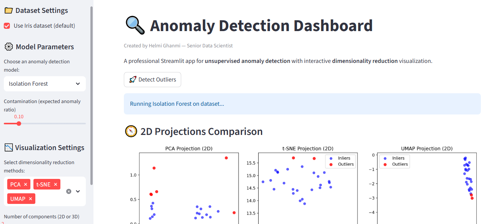
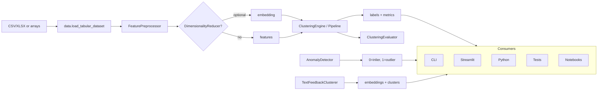

<!--
Path: README.md
Author: GHANMI Helmi
Current Role: AI Engineer
Past Role: Researcher in Applied Mathematics
Research Profile: https://www.researchgate.net/profile/Ghanmi-Helmi
-->

# ML Unsupervised Toolkit

[](https://github.com/helmighanmi/ml-unsupervised/actions/workflows/ci.yml)
[](https://github.com/helmighanmi/ml-unsupervised/actions/workflows/security.yml)
[](pyproject.toml)
[](LICENSE)

A production-oriented Python toolkit for **clustering, dimensionality reduction, anomaly detection, and text-feedback clustering** — with a package-first design, explicit algorithm contracts, tests, CI, and reproducible CLI/Docker workflows.

> **Package first:** production logic lives in `src/ml_unsupervised/`. Notebooks and Streamlit are thin clients of that package, never the owner of model logic.



## Start here (under 5 minutes)

```bash
python3.11 -m venv .venv
source .venv/bin/activate
python -m pip install --upgrade pip
python -m pip install -e ".[dev]"

ml-unsupervised demo
```

The demo runs a reproducible clustering pipeline on the bundled sample dataset and prints a JSON summary (rows, clusters, metrics). You can also run `make demo`.

## What’s included

| Capability | Algorithms / components | Primary API |
|---|---|---|
| **Clustering** | KMeans, DBSCAN, HDBSCAN, Agglomerative, GMM, Spectral, Birch | `ClusteringEngine`, `ClusteringPipeline` |
| **Dimensionality reduction** | PCA, t-SNE, UMAP, Kernel PCA, ICA, NMF, Factor Analysis | `DimensionalityReducer` |
| **Anomaly detection** | Isolation Forest, One-Class SVM, Local Outlier Factor | `AnomalyDetector` (`0=inlier, 1=outlier`) |
| **Text feedback** | SentenceTransformer embeddings + clustering | `TextFeedbackClusterer` |
| **Evaluation** | Silhouette, Davies–Bouldin, Calinski–Harabasz (noise-aware) | `ClusteringEvaluator` |
| **Workflows** | Preprocessing, optional reduction, fit/predict, persistence | `ClusteringPipeline`, CLI |

Optional extras: `.[ui]` (Streamlit/XLSX), `.[heavy]` (HDBSCAN/UMAP), `.[nlp]` (SentenceTransformers), `.[notebooks]`, `.[dev]`.

## Which API should I use?

| Use case | Recommended |
|---|---|
| End-to-end tabular clustering (scale → reduce → cluster → metrics → save) | `ClusteringPipeline` |
| Direct model control / algorithm comparison | `ClusteringEngine`, `DimensionalityReducer`, `AnomalyDetector` |
| Text feedback themes | `TextFeedbackClusterer` |
| Quick scripts / notebook migration | `run_*` helpers in `clustering`, `dimensionality_reduction`, `anomaly_detection` |
| No-code execution | `ml-unsupervised` CLI |

**Inference note:** only estimators that support out-of-sample prediction (e.g. KMeans/GMM/Birch) expose `predict()`; others (e.g. DBSCAN, Agglomerative) raise a clear error — by design.

## Architecture



See [docs/architecture.md](docs/architecture.md) for boundaries and design decisions.

## Quick examples

### Python (recommended)

```python
from sklearn.datasets import load_iris
from ml_unsupervised import ClusteringPipeline

X = load_iris().data
pipeline = ClusteringPipeline(
    scaler="standard",
    reduction_method="pca",
    n_components=2,
    clustering_method="kmeans",
    clustering_params={"n_clusters": 3, "random_state": 42, "n_init": 10},
)
result = pipeline.fit_predict(X)
print(result.metrics.to_dict() if result.metrics else None)
pipeline.save("artifacts/iris.joblib")
```

### CLI

```bash
ml-unsupervised cluster data/sample_customers.csv \
  --features age annual_income spending_score \
  --method kmeans --param n_clusters=3 --param random_state=42 \
  --reduce pca --components 2 \
  --output outputs/clustered.csv

ml-unsupervised anomaly data/sample_customers.csv \
  --features age annual_income spending_score \
  --method isolation_forest --param contamination=0.05 \
  --output outputs/anomalies.csv
```

### Streamlit

```bash
python -m pip install -e ".[ui]"
streamlit run streamlit_app/app.py
# or: make ui
```

## Documentation

- [Tutorial](docs/tutorial.md) — from data to interpreted results
- [Algorithm selection](docs/algorithm-selection.md) — which method and when
- [Metrics & interpretation](docs/metrics.md) — how to read results and caveats
- [Architecture](docs/architecture.md) — layers and boundaries
- [Development](docs/development.md) — local setup and checks
- [Testing](docs/testing.md) — strategy and quality gates
- [Runbook](docs/runbook.md) — common operational issues
- [Migration](docs/migration.md) — from the original project layout
- [Model card](docs/model-card.md) — intended use, limitations, ethics
- [Glossary](docs/glossary.md)

## Docker

```bash
docker build --target runtime -t ml-unsupervised:local .   # CLI image
docker run --rm ml-unsupervised:local --help
docker compose up --build                                   # UI (Streamlit) on :8501
```

## Quality

```bash
make quality   # ruff check, ruff format --check, mypy, pytest+coverage
```

CI runs on Python 3.11/3.12 with coverage reporting, Docker build, dependency audit, and CodeQL (see `.github/workflows/`).

## Repository layout

```text
src/ml_unsupervised/   # production package
streamlit_app/         # thin UI client
notebooks/             # analysis only
tests/{unit,integration}
docs/                  # guides, ADRs, model card
configs/ data/ examples/ benchmarks/
```

## License

MIT — see [LICENSE](LICENSE). Third-party dependencies retain their respective licenses. See [CITATION.cff](CITATION.cff) for citation metadata.
